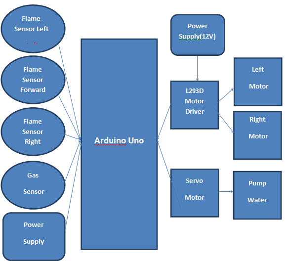
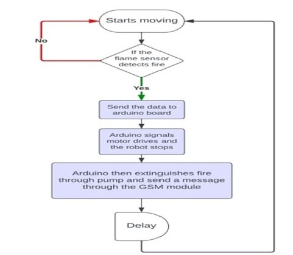
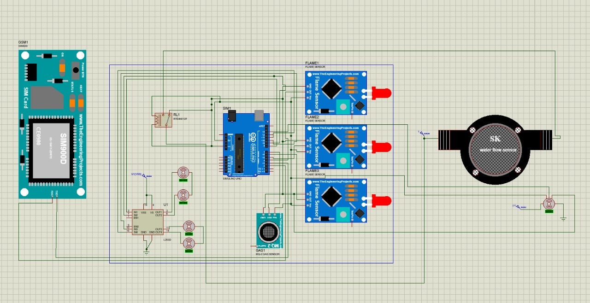
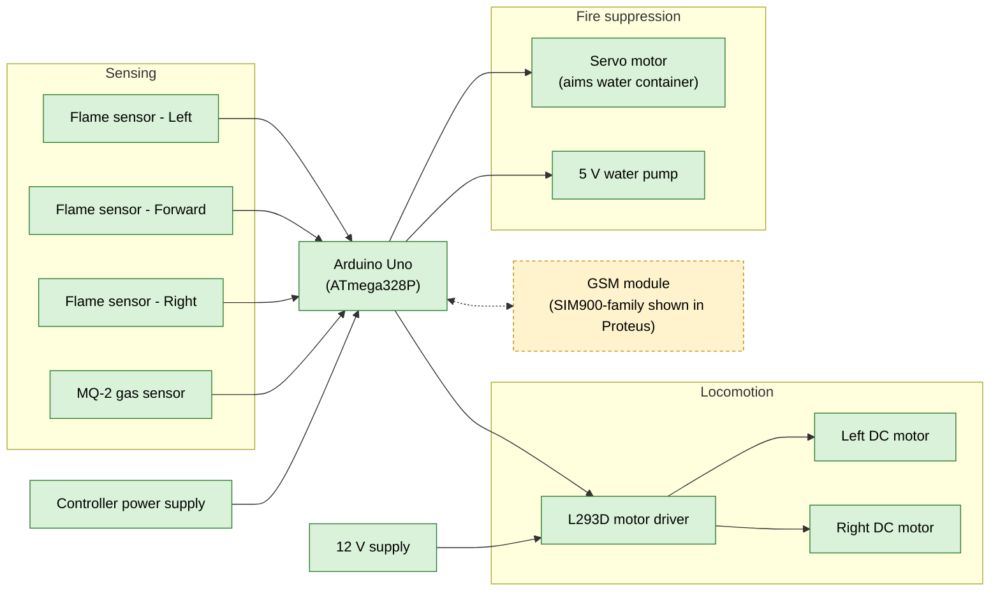
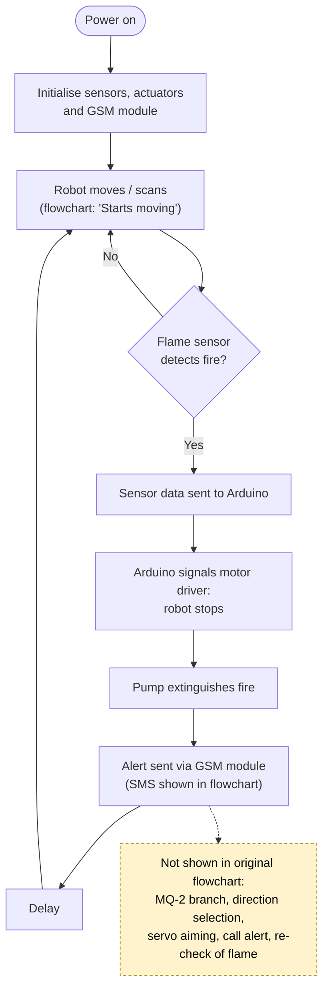
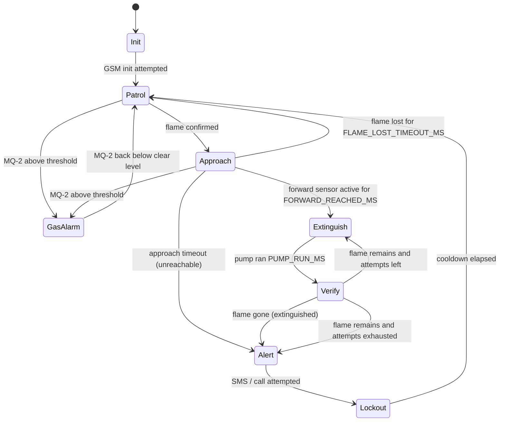

# Fire Fighting Robot with SMS and Call Alert Using Arduino


-lightgrey)


An Arduino Uno-based robot concept that locates a flame with three directional IR flame sensors, drives toward it with an L293D motor driver, extinguishes it with a servo-aimed water pump and alerts the owner through a GSM module. Academic team project, ECE, Hirasugar Institute of Technology, Nidasoshi (VTU), 2023–24.

> **Evidence status:** The original 2023–24 materials in this repository are the project report, its block diagram, flowchart and a Proteus schematic. The original Arduino code, photographs and test results are **not** available. A **new reference firmware** (2026) and a build guide have been added so the design can be built and verified; the firmware compiles for the Uno but is **not hardware-tested** and is not the original code. See [`docs/PROJECT_AUDIT.md`](docs/PROJECT_AUDIT.md).

## At a glance (30-second summary)

| | |
|---|---|
| **Problem** | Fires in homes, labs and workshops need early detection and a response without exposing people to risk. |
| **Solution** | Flame-seeking robot that stops near the fire, sprays water and sends a GSM alert. |
| **Controller** | Arduino Uno |
| **Sensors** | 3× IR flame sensor (left / forward / right), MQ-2 gas sensor |
| **Actuators** | 2× DC motors via L293D; servo-mounted 5 V water pump |
| **Communication** | GSM module (SMS; call alert is in the title but not shown in the flowchart) |
| **Tools** | Arduino IDE, Proteus |
| **Technologies** | Embedded C/C++, digital/analog I/O, motor-driver interfacing, UART/AT commands |

## Key features (as documented in the report)

- Directional flame sensing with three sensors.
- Motor drive through an L293D dual H-bridge.
- Water pump on a servo so the spray direction can be changed.
- GSM alert on fire detection.
- Gas sensor (MQ-2) included in the design.

Not claimed: obstacle avoidance, mapping/navigation, AI, IoT connectivity (these appear only in the report's generic text or future scope).

## Project gallery

| Block diagram (from report) | Flowchart (from report) |
|---|---|
|  |  |



*Proteus schematic from the report: a design drawing, not a hardware photograph.*

**Hardware photographs and demonstration video: not yet available.** See the capture checklist in [`media/README.md`](media/README.md).

## Hardware architecture

Green = confirmed in the report's block diagram. Yellow/dashed = GSM link, taken from the title, flowchart and Proteus schematic (the report's block diagram omits it).



## Hardware components

| Component | Function | Verification |
|---|---|---|
| Arduino Uno | Main controller | Confirmed |
| 3× IR flame sensor modules | Detect fire direction | Confirmed (model unknown) |
| MQ-2 | Gas/smoke sensing | Confirmed |
| L293D | Motor driver | Confirmed |
| 2× DC motors | Locomotion | Confirmed (Proteus shows 4) |
| Servo + 5 V pump | Aim and spray water | Confirmed |
| GSM module | SMS / call alert | Existence confirmed; model unverified |
| 12 V supply | Motor power | Unverified |

Full list: [`hardware/BOM.md`](hardware/BOM.md). Pin mapping is **not verified**: [`hardware/pin_mapping.md`](hardware/pin_mapping.md).

## Software and tools

Arduino IDE and Proteus are named in the report. The original source is not in the repository. A new reference implementation is provided in [`firmware/FireFightingRobot/`](firmware/FireFightingRobot/); see [`firmware/README.md`](firmware/README.md) and [`docs/SOFTWARE_DOCUMENTATION.md`](docs/SOFTWARE_DOCUMENTATION.md).

## Working principle and flowchart

1. Robot moves while monitoring flame sensors.
2. A flame sensor detects fire and sends data to the Arduino.
3. Arduino signals the motor driver; the robot stops.
4. The pump sprays water and a message is sent through the GSM module.
5. After a delay, the cycle repeats.



Not shown in the original flowchart: MQ-2 handling, turning logic, servo aiming, call alert, fire-out check. Theory behind each subsystem: [`docs/SYSTEM_OVERVIEW.md`](docs/SYSTEM_OVERVIEW.md).

## Firmware architecture (reference implementation, not the original code)

A non-blocking state machine written from the report's design: `Init → Patrol → Approach → Extinguish ⇄ Verify → Alert → Lockout`, plus a `GasAlarm` state. It includes flame debouncing, a motor dead-time guard, a pump/motor interlock, a bounded pump run time, rate-limited SMS/call alerts and a `secrets.h` file for the phone number. Compiles for the Uno (10.3 KB flash, 471 B RAM); **not hardware-tested**.



Pin numbers in the reference firmware are **proposed**, not the original wiring ([`hardware/pin_mapping.md`](hardware/pin_mapping.md)).

## GSM SMS / call communication

The report states that a GSM module sends an SMS and call alert; the original commands and module are unknown. The reference firmware uses standard AT commands (`AT`, `ATE0`, `AT+CMGF=1`, `AT+CREG?`, `AT+CMGS`, `ATD`, `ATH`), checks every response with a timeout, retries failed SMS and rate-limits alerts. Status: **Pending Validation** on hardware.

## Proteus simulation

A Proteus schematic is shown above and in [`simulation/README.md`](simulation/README.md). The repository has no `.pdsprj` file and no recorded simulation run, so simulation results are not claimed.

## Testing and validation status

15 test cases are defined in [`docs/TESTING_AND_VALIDATION.md`](docs/TESTING_AND_VALIDATION.md). **All are Pending.**

## Engineering considerations

- Arduino pins cannot drive motors or pumps directly; drivers are needed.
- Servo, pump and GSM bursts can overload a shared supply; separate supplies with a common ground are advisable.
- IR flame sensors respond to sunlight, so false triggers must be handled.
- `delay()`-based waiting blocks sensor reads; `millis()` timing is preferable.

These are general considerations, listed in [`hardware/pin_mapping.md`](hardware/pin_mapping.md) and [`docs/HARDWARE_DOCUMENTATION.md`](docs/HARDWARE_DOCUMENTATION.md); they are not claims about the original build.

## Limitations

Limited sensor range, blind spots, weak obstacle handling, no recorded tests, undocumented power design. See [`docs/LIMITATIONS.md`](docs/LIMITATIONS.md).

## Future improvements (Proposed)

Several items are implemented in the reference firmware (non-blocking timing, flame re-check, pump timeout, SMS rate limiting). Still open: obstacle sensors, analog flame sensing for distance, a watchdog timer, hardware test evidence and a demo video.

## Skills demonstrated

Skills reflected by the project design: embedded systems and Arduino programming, sensor interfacing, digital I/O, motor-driver interfacing, GSM/serial communication, hardware–software integration, Proteus simulation and technical documentation. Individual contributions are not recorded in the source material.

## Repository structure

```text
├── README.md
├── LICENSE          MIT (code and documentation written for this repository)
├── docs/            audit, system/hardware/software docs, testing, limitations,
│   │                changelog, portfolio text, interview prep
│   └── diagrams/    Mermaid sources (.mmd)
├── hardware/        BOM, pin mapping
├── firmware/        reference firmware, bring-up test sketch
├── simulation/      status note (Proteus screenshot only)
├── media/           figures extracted from the report; capture checklist
└── report/          original project report (.docx)
```

## How to reproduce

The original build cannot be reproduced exactly (original firmware, pins and models are missing), but the design can be rebuilt with the new reference firmware by following [`docs/IMPLEMENTATION_GUIDE.md`](docs/IMPLEMENTATION_GUIDE.md): parts, power plan, wiring, bench bring-up, tuning and tests. Missing information about the original is listed in [`docs/PROJECT_AUDIT.md`](docs/PROJECT_AUDIT.md#7-missing-information).

## Contributors and acknowledgements

Team (ECE, HIT Nidasoshi): Abhishek Mathad, Ankit Avaragol, Atharv Joshi, Nihalahmad Kumanali. Guide: Prof. S. S. Kamate. Repository maintained by Nihalahmad Kumanali.

## Disclaimer

An academic prototype for learning. Hardware validation is pending, and it is not a certified fire-protection device. Original report: [`report/original_project_report.docx`](report/original_project_report.docx) (academic team work, not covered by the MIT license).
