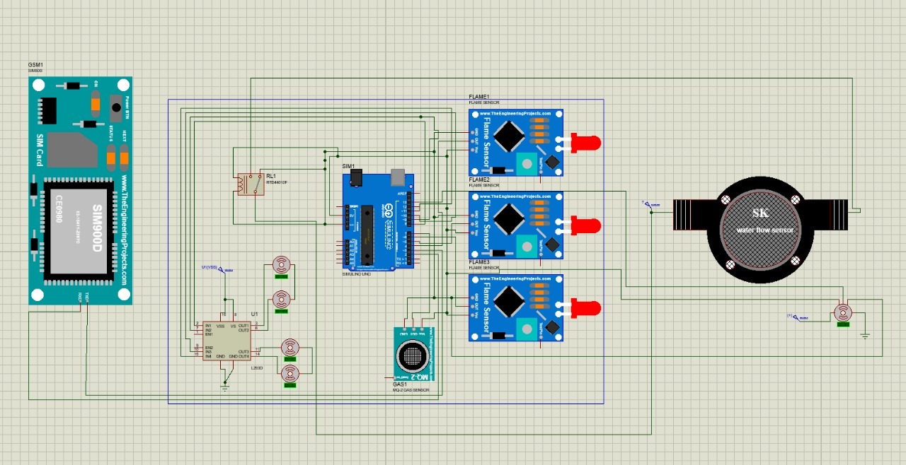

# Hardware Documentation

Component list and verification: [`../hardware/BOM.md`](../hardware/BOM.md). Pin assignments (currently none verified): [`../hardware/pin_mapping.md`](../hardware/pin_mapping.md).

## 1. Hardware as documented in the report

| Subsystem | Documented design | Source |
|---|---|---|
| Controller | Arduino Uno | R-text, R-block |
| Fire sensing | 3 flame sensors facing left / forward / right | R-text, R-block |
| Gas sensing | MQ-2 | R-block, R-proteus |
| Drive | L293D driving left and right DC motors; 12 V supply to the driver | R-block |
| Extinguishing | 5 V pump in a water container on a servo | R-text, R-block |
| Alerting | GSM module (SMS; call per title) | README, R-flow, R-proteus |

## 2. Simulation schematic

*Proteus schematic from the report. It contains an Arduino Uno, three flame-sensor modules, an MQ-2, an L293D with motor symbols, a SIM900D GSM symbol, a relay, and a water-flow sensor. Wire-level connections were not transcribed.*

## 3. Open hardware questions

| Question | Why it matters |
|---|---|
| How is the pump driven (relay, transistor, direct)? | Direct drive from a pin is unsafe; the schematic's relay suggests a relay but this is unconfirmed. |
| What supplies the GSM module? | Burst current can reset a weak supply. |
| Is the servo powered from the Uno's 5 V pin? | Servo current can brown out the controller. |
| Are there two or four drive motors? | Determines current draw and driver loading. |
| Is the flow sensor part of the real build? | It would allow detecting an empty tank, which no document mentions. |

## 4. Design decisions vs. recommendations

- **Design decisions (from the report):** the components and block layout in section 1.
- **Recommendations (Proposed, not implemented):** separate regulated supplies for the motors, servo/pump and GSM module with a common ground; transistor/relay pump driver with a flyback diode; hardware or software serial chosen to avoid USB conflicts; a fuse and reverse-polarity protection on the battery input; shielding sensors from sunlight and motor noise, since IR flame sensors respond to sunlight and incandescent light.
