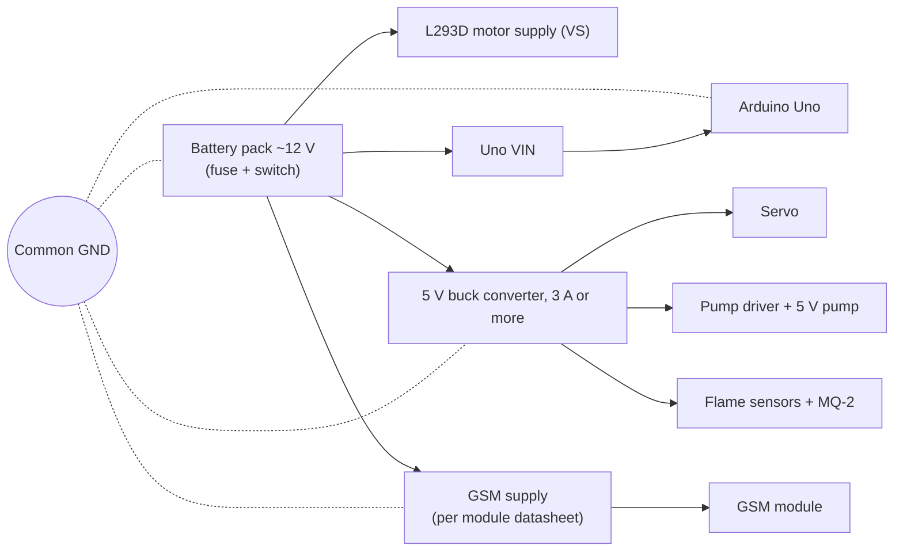
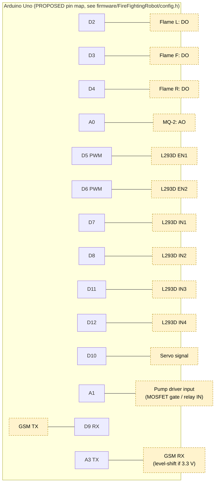

# Implementation Guide: Building the Robot

> **Status of this guide:** it describes how to build the project using the **new reference firmware** in [`../firmware/FireFightingRobot/`](../firmware/FireFightingRobot/). The firmware compiles for the Arduino Uno but **has not been run on hardware**; part choices, pin numbers and thresholds are **Proposed**. Work through the stages in order and record results in [`TESTING_AND_VALIDATION.md`](TESTING_AND_VALIDATION.md).

## Stage 0 – Safety

- Test fire only with a tiny flame (a candle or lighter) on a non-flammable surface, with an extinguisher or a wet cloth to hand, an adult/supervisor present, and nothing flammable nearby.
- Never test with real gas leaks. Use a lighter held near the MQ-2 only briefly, outdoors, and keep it away from the robot's electronics.
- Add a fuse and a master switch on the battery.

## Stage 1 – Parts (Proposed)

| Item | Qty | Notes |
|---|---:|---|
| Arduino Uno + USB cable | 1 | |
| IR flame sensor modules (3-/4-pin, with DO) | 3 | Check whether DO is LOW or HIGH on flame, then set `FLAME_ACTIVE_LEVEL` |
| MQ-2 module (with AO) | 1 | |
| L293D (IC on breadboard/PCB, or motor-driver board) | 1 | |
| Geared DC motors + wheels + caster, chassis | 2 | Rated for your battery voltage |
| Servo (SG90 or MG90S class) | 1 | Carries the water container |
| 5 V mini water pump + silicone tube + small container | 1 | |
| Pump driver: logic-level N-MOSFET module or a relay module, plus a flyback diode across the pump | 1 | |
| GSM module (SIM800L, SIM900A or equivalent) + SIM with SMS/calls | 1 | Check its supply voltage and logic level |
| Battery pack ≈ 11–12 V (e.g. 3×18650 with holder and protection) | 1 | |
| 5 V buck converter, 3 A or more | 1 | |
| Supply for the GSM module per its datasheet (SIM800L: ≈ 4 V buck) | 1 | |
| Capacitors: ≈ 1000 µF near the GSM supply, ≈ 470 µF near the servo/pump rail | 2 | |
| Resistors for a 5 V → 3.3 V divider (e.g. 1 kΩ + 2 kΩ) if the GSM module is 3.3 V | 2 | |
| Fuse, switch, jumper wires, breadboard/perfboard | – | |

## Stage 2 – Power plan



Rules: every ground connected together; motors and GSM never powered from the Uno's 5 V pin; the L293D logic pin (VSS, pin 16) takes 5 V while its motor pin (VS, pin 8) takes the battery voltage.

## Stage 3 – Wiring (matches `config.h`)



| Arduino pin | Connect to | Note |
|---|---|---|
| D2 / D3 / D4 | Flame sensor DO: left / forward / right | Sensors powered from 5 V rail |
| A0 | MQ-2 AO | MQ-2 powered from 5 V rail |
| D7, D8, D5 | L293D IN1, IN2, EN1 (left motor) | |
| D11, D12, D6 | L293D IN3, IN4, EN2 (right motor) | |
| D10 | Servo signal | Servo power from the 5 V rail |
| A1 | Pump driver input | Never connect the pump itself to a pin |
| D9 | GSM TX | |
| A3 | GSM RX | Through a voltage divider if the module is 3.3 V |
| D0 / D1 | Unused (USB debug) | |

If a motor spins the wrong way, swap its two L293D output wires. If the module's flame output is active-HIGH or the pump driver is active-LOW, change `FLAME_ACTIVE_LEVEL` or `PUMP_ON_LEVEL` in `config.h`.

**Sensor placement:** mount the left and right sensors at about 30–45° off the centre line and the forward sensor straight ahead, at roughly flame height, with a small shield between sensors to narrow their fields of view. Keep them away from direct sunlight.

## Stage 4 – Software setup

1. Install the Arduino IDE 2.x and select **Arduino Uno**.
2. Copy `firmware/FireFightingRobot/secrets.h.example` to `secrets.h` in the same folder and put your number in it (international format). `secrets.h` is git-ignored.
3. Open `firmware/BringUpTest/BringUpTest.ino` and upload it first (Stage 5).
4. When bring-up passes, open `firmware/FireFightingRobot/FireFightingRobot.ino` and upload it.

Or with the Arduino CLI:
```bash
arduino-cli core install arduino:avr
arduino-cli lib install Servo
arduino-cli compile --fqbn arduino:avr:uno firmware/FireFightingRobot
arduino-cli upload  --fqbn arduino:avr:uno -p <your-port> firmware/FireFightingRobot
```

## Stage 5 – Bring-up, one peripheral at a time

Wheels off the ground. Serial Monitor at 9600 baud, no line ending. Send the letter shown.

| Step | Command | Pass condition | Test ID |
|---|---|---|---|
| Flame sensors | `f` | Each sensor shows 1 only when a flame is held in front of it | T-02..T-05 |
| Gas sensor | `g` | Value changes when exposed to smoke (after ~20 s warm-up) | T-12 |
| Motors | `w`, `s`, `l`, `r` | Forward, reverse, pivot left, pivot right as named; swap wires if wrong | T-06 |
| Servo | `v` | Smooth sweep, no controller reset | T-09 |
| Pump | `p` | Water flows for 1 s; Uno does not reset | T-08 |
| GSM | `a`, then `AT` | Replies `OK`; `AT+CREG?` shows `,1` or `,5`; `AT+CSQ` shows signal | T-10 |

Do not continue past a failed step. Typical fixes are in the troubleshooting table below.

## Stage 6 – Tune `config.h`

| Setting | How to tune |
|---|---|
| Flame sensor potentiometers | Turn until the forward sensor triggers only at spraying distance (about 20–30 cm) for a small flame, and stays quiet in room light |
| `FORWARD_REACHED_MS` | Time the robot drives while the forward sensor sees the flame before stopping; adjust until it stops at spraying distance |
| `PATROL_SPEED`, `APPROACH_SPEED`, `TURN_SPEED` | Slow enough to turn on the flame before overshooting |
| `GAS_ALARM_ADC`, `GAS_CLEAR_ADC` | Read `g` in clean air, then with a safe test source; set alarm well above the clean-air value |
| `PUMP_RUN_MS`, servo sweep | Aim the spray at the flame |
| `PATROL_DRIVE_ENABLED` | Set `false` for a stationary first test |

## Stage 7 – System tests

1. **Stationary:** set `PATROL_DRIVE_ENABLED = false`. Present a flame at 30–40 cm. Expect: approach, stop, pump, verify, SMS.
2. **Directional:** flame left, then right, then ahead. Expect it to pivot toward the flame.
3. **Driving patrol:** enable patrol on a clear table-top arena. Remember there is no obstacle sensor, so watch the robot.
4. **Alert logic:** with the flame removed during `VERIFY`, the SMS says "extinguished". With a flame kept present, it retries up to 3 times, then sends "still detected" and a call.
5. **Gas:** exposing the MQ-2 to smoke should stop the robot and send a gas SMS (after warm-up).
6. **Fault:** remove the SIM or antenna; the robot must still extinguish and recover (T-14).

Photograph and film each test (see [`../media/README.md`](../media/README.md)) and fill in the results table.

## Stage 8 – Simulating in Proteus (optional)

1. In the Arduino IDE use **Sketch → Export Compiled Binary** to obtain the `.hex`.
2. Rebuild the schematic from the report figure with the pins in the table above (the original Proteus file is not available).
3. Double-click the Arduino, set **Program File** to the `.hex`, and run.
4. Use Proteus' virtual terminal on the GSM serial lines to watch the AT commands.

## Troubleshooting

| Symptom | Likely cause | Fix |
|---|---|---|
| Uno resets when pump or servo starts | Shared supply sags | Separate 5 V rail, add capacitors, check ground |
| GSM replies garbage or nothing | Wrong baud, TX/RX swapped, weak supply | Try `AT` at 9600, swap lines, supply the module separately with enough current |
| SMS fails with `+CMS ERROR` | No credit/network, wrong number format | Check SIM in a phone; use `+countrycode...` |
| Robot never sees flame | `FLAME_ACTIVE_LEVEL` wrong or pot set too low | Check `f` output in bring-up |
| Flame sensors trigger constantly | Sunlight/lamp, pot too sensitive | Shield sensors, lower sensitivity |
| Motors twitch or driver gets hot | Motor current too high, no PWM, wrong VS | Check motor rating; L293D is about 600 mA per channel |
| Servo jitters | Shared 5 V or timer interference | Separate rail; the firmware detaches the servo when idle |
| Pump stays on | Driver wired active-LOW | Set `PUMP_ON_LEVEL` |
