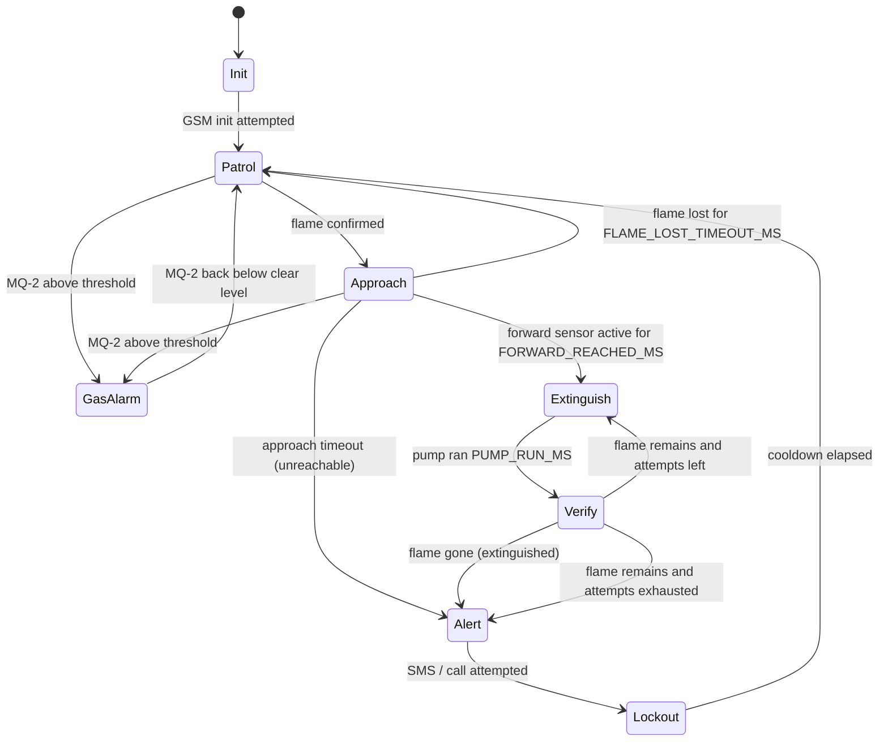

# Software Documentation

## 1. Status

| Item | Status |
|---|---|
| Original 2023–24 firmware | **Not available**, not recovered |
| Reference firmware (`firmware/FireFightingRobot/`) | **New implementation (2026)**, written from the report's design. Compiles for the Uno. **Not hardware-tested**; not the code used in the original project |

Pin numbers, thresholds and timings in the reference firmware are **Proposed** values.

## 2. Tools

Arduino IDE / Arduino language and Proteus (named in the report); the Servo and SoftwareSerial libraries (reference firmware).

## 3. Behaviour taken from the report

Initialise → move while monitoring flame sensors → on detection stop → pump + GSM message → delay → repeat.

## 4. Reference firmware architecture

| State | Behaviour | Exit |
|---|---|---|
| `Init` | Stay still; wait for GSM boot; initialise GSM (AT, echo off, text mode, network registration) | Init attempted |
| `Patrol` | Drive forward slowly (configurable); watch sensors | Flame confirmed, or gas alarm |
| `Approach` | Pivot toward the active side sensor; drive forward when the forward sensor is active | Forward sensor active for `FORWARD_REACHED_MS`; flame lost; timeout |
| `Extinguish` | Stop wheels, sweep servo, run pump for `PUMP_RUN_MS` | Pump time elapsed |
| `Verify` | Wait, re-check flame | Gone → alert; still there → retry up to 3× |
| `Alert` | Send SMS (retries), optional call, rate-limited | Always → `Lockout` |
| `Lockout` | Stay stopped (5 s after success, 30 s after failure) | Cooldown elapsed |
| `GasAlarm` | Stop everything, send gas SMS | MQ-2 below clear level |

## 5. Engineering decisions

| Topic | Decision | Reason |
|---|---|---|
| Timing | `millis()` state timing; no `delay()` in the control loop | Sensors keep being read |
| GSM | Blocking but timeout-bounded, and only with actuators off | AT exchange is sequential; avoids pump + GSM current peak |
| Flame input | Hysteresis counter (200 ms to confirm) | Rejects flicker and short IR spikes |
| Motor protection | Dead-time stop before reversing | Protects the H-bridge |
| Pump safety | Interlock refuses start while wheels move; bounded run time; forced off outside spraying | Avoids unsafe switching and water waste |
| Servo | Attached only while spraying | Avoids Servo/SoftwareSerial interrupt conflicts |
| Gas | Motors stop on gas alarm | Motors and relays can spark |
| Alerts | Rate-limited; message states the outcome | Avoids SMS flooding; useful content |
| Secrets | Phone number in git-ignored `secrets.h` | No personal data in the repository |
| Memory | No `String`, `F()` for text | 2 KB RAM |

## 6. Known limitations of the reference firmware

- Distance to the flame is estimated by time (digital sensors give no range); tune `FORWARD_REACHED_MS`.
- No obstacle detection; patrol is straight-line.
- GSM exchange blocks the loop for up to about 30 s during an alert; the robot is stopped then.
- No watchdog timer (blocking waits would need resets); proposed future work.
- Gas thresholds are uncalibrated placeholders.
- Not hardware-tested.

## 7. Build instructions

See [`../firmware/README.md`](../firmware/README.md) and [`IMPLEMENTATION_GUIDE.md`](IMPLEMENTATION_GUIDE.md).
