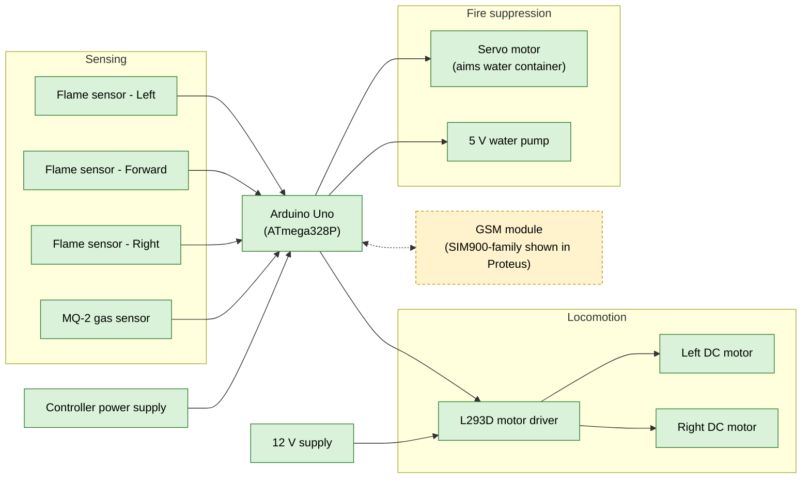
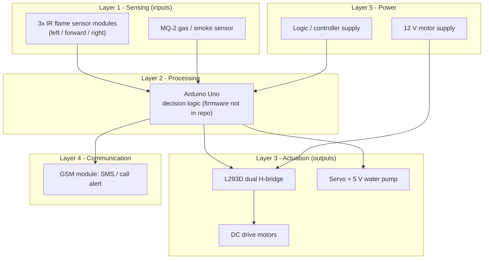
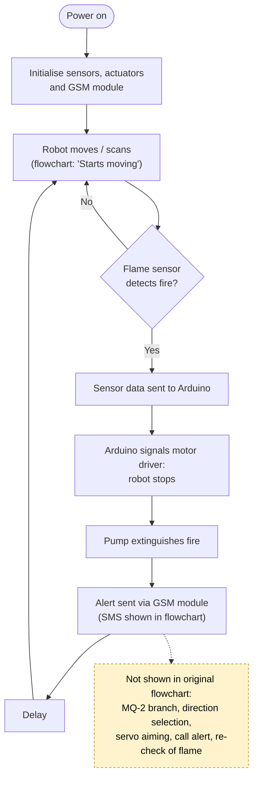

# System Overview

> Sources: project report text and figures. Items not in the report are labelled *general theory* or *Proposed*. Component details marked dashed/yellow in diagrams are unverified.

## 1. Block diagram

Green = confirmed in the report's block diagram. Yellow/dashed = from the title, flowchart or Proteus schematic but absent from the report's block diagram (the GSM link).

The report's original figure is kept for reference: [`../media/images/fig01_block_diagram_original.png`](../media/images/fig01_block_diagram_original.png).

## 2. Sensor → controller → actuator architecture

## 3. Working principle

**Implemented per the report [R-text, R-flow]**

1. The robot starts moving and the three flame sensors are monitored.
2. If a flame sensor detects fire, the data goes to the Arduino.
3. The Arduino signals the motor driver and the robot stops.
4. The pump sprays water; the Arduino sends a message through the GSM module.
5. A delay passes and the cycle repeats.

**Not shown in the flowchart, so not claimed as implemented:** MQ-2 gas handling, selection of turn direction from the three sensors, servo aiming, a call alert, a "fire is out" check.

## 4. How the main subsystems work (general theory)

| Subsystem | Principle | Role in this project |
|---|---|---|
| IR flame sensor | A photodiode/phototransistor sensitive to the infrared emitted by flames (roughly 760–1100 nm). Typical modules add a comparator with a potentiometer to set the threshold, giving a digital output (and often an analog one). | Three modules (left/forward/right) give coarse direction. Model and output used are unverified. |
| Directional sensing | Each sensor sees a limited angle. Whichever sensor sees the flame indicates a side. | The report says three sensors "sense in which direction the fire is burning". The exact turning rule is not documented. |
| L293D | A dual H-bridge: two logic inputs per motor set the direction, an enable input gates or PWM-controls speed, and a separate motor supply powers the load. | Drives left and right DC motors from the Uno. |
| Servo + pump | A hobby servo moves to an angle set by a pulse width. The pump moves water when powered. | The container and pump sit on a servo so the spray direction can be changed [R-text]. |
| GSM module | A cellular modem controlled by AT commands over a serial link, e.g. text mode is selected with `AT+CMGF=1`, a message is sent with `AT+CMGS`, and a voice call is placed with `ATD`. | Sends the fire alert. The actual commands used by the project are unknown. |
| MQ-2 | A metal-oxide gas sensor whose resistance changes with combustible gas/smoke concentration, read as an analog voltage after heater warm-up. | Included for gas/smoke sensing. Its use in the control logic is undocumented. |

## 5. Why an Arduino Uno

The report names the Uno as the controller. A reasonable fit: it offers enough digital and analog pins for three flame inputs, one analog gas input, motor-driver control lines, a servo output and a serial link, and it is easy to program and to simulate in Proteus. Its limits (5 V pin current, one hardware serial port, 2 KB RAM) matter for GSM and servo use.
